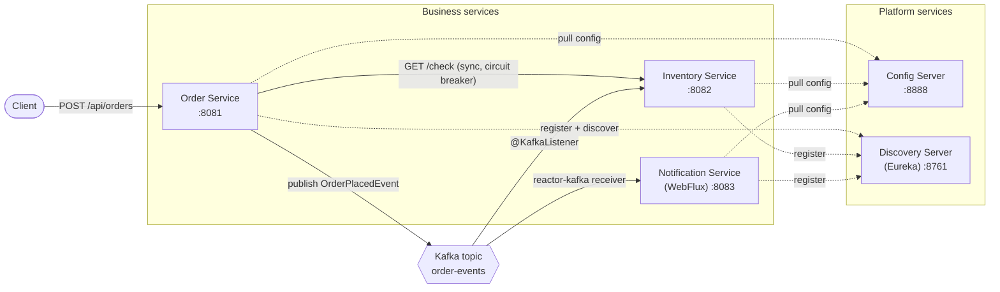
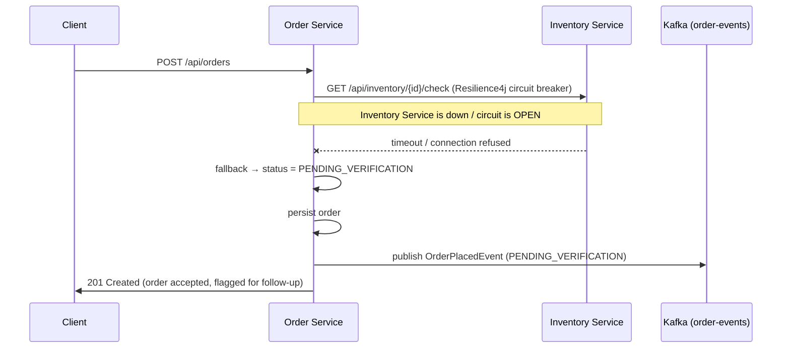

# Event-Driven Order Processing

A small Kafka-based microservices system — **Order Service**, **Inventory Service**, and
**Notification Service** — plus the infrastructure around them that makes it a real
microservices system and not three apps that happen to share a broker: centralized
configuration (Spring Cloud Config), service discovery (Eureka), and a Resilience4j circuit
breaker that demonstrates graceful degradation when a downstream dependency is unavailable.

Order Service accepts an order, synchronously checks stock on Inventory Service (behind that
circuit breaker), persists the order, and publishes an `OrderPlacedEvent` to Kafka. Inventory
Service and Notification Service both consume that event independently and asynchronously —
one decrements stock, the other composes a customer notification — and neither one can block
or fail the checkout flow, which is the whole point of doing this with events instead of a
chain of synchronous calls.

## Architecture



The only synchronous, cross-service call in the whole system is Order Service asking
Inventory Service "can you fulfil this?" before confirming an order — everything downstream
of that decision (updating stock, notifying the customer) happens through Kafka, so a slow or
unavailable Notification Service, for example, can never slow down or fail checkout.

### What happens when Inventory Service is unreachable



Checkout still succeeds — it just tells the truth about what it couldn't verify, instead of
either failing the whole request or silently pretending the stock check passed.

## Tech stack

- Java 21, Spring Boot 3.4, Spring Cloud 2024.0 ("Moorgate")
- Apache Kafka (`spring-kafka` for Order/Inventory, Reactor Kafka for Notification)
- Spring Cloud Config Server (native backend) + Netflix Eureka (service discovery)
- Resilience4j (circuit breaker + time limiter) over a `@LoadBalanced` `RestClient`
- Spring Data JPA + H2 (Order Service, Inventory Service)
- Spring WebFlux + Project Reactor (Notification Service)
- JUnit 5, Mockito, AssertJ, `spring-kafka-test` (embedded Kafka), Awaitility, `reactor-test`
- Maven (multi-module reactor), Docker multi-stage builds, Docker Compose, GitHub Actions

## Repository layout

```
event-driven-order-processing/
├── pom.xml                    # parent/aggregator (Maven multi-module reactor)
├── common-events/             # shared OrderPlacedEvent contract (the only thing services share)
├── discovery-server/          # Eureka
├── config-server/             # Spring Cloud Config (native backend → config-repo/)
├── order-service/             # REST API, stock check + circuit breaker, Kafka producer
├── inventory-service/         # product catalog/stock, Kafka consumer (@KafkaListener)
├── notification-service/      # WebFlux + Reactor Kafka consumer, SSE stream
├── docker-compose.yml         # one-command demo environment
└── .github/workflows/ci.yml   # build → test → docker build
```

## Running it locally

### Option A — Docker Compose (everything, one command)

```bash
docker compose up --build
```

This starts Kafka, Kafka UI (topic browser), Config Server, Discovery Server, and all three
business services. First boot takes a minute or two (multi-stage Maven builds + Kafka KRaft
startup). Once it's up:

| Service                     | URL                                      |
|------------------------------|-------------------------------------------|
| Order Service                | http://localhost:8081/api/orders          |
| Inventory Service            | http://localhost:8082/api/inventory       |
| Notification Service         | http://localhost:8083/api/notifications   |
| Eureka dashboard             | http://localhost:8761                     |
| Config Server                | http://localhost:8888/order-service/default |
| Kafka UI (browse the topic)  | http://localhost:8080                     |

### Option B — Run services individually (no Docker)

Useful for iterating on one service without rebuilding images. Each service's
`application.yml` already defaults to `localhost` for Kafka/Config/Eureka, so you just need a
local Kafka broker (`docker compose up kafka` is the easiest way to get just that) and then,
in separate terminals, from the repo root:

```bash
mvn -pl common-events,discovery-server install   # build+install shared jar, start Eureka
mvn -pl discovery-server spring-boot:run
mvn -pl config-server spring-boot:run
mvn -pl common-events,inventory-service -am spring-boot:run
mvn -pl common-events,order-service -am spring-boot:run
mvn -pl common-events,notification-service -am spring-boot:run
```

### Try it

```bash
# A normal order - Inventory Service has stock, so it's confirmed immediately.
curl -s -X POST localhost:8081/api/orders \
  -H 'Content-Type: application/json' \
  -d '{"productId":"PRODUCT-1","quantity":2,"customerEmail":"you@example.com"}' | jq

# More than the seeded stock - rejected, but still recorded and still notified.
curl -s -X POST localhost:8081/api/orders \
  -H 'Content-Type: application/json' \
  -d '{"productId":"PRODUCT-5","quantity":999,"customerEmail":"you@example.com"}' | jq

# Watch the notification land (SSE stream):
curl -N localhost:8083/api/notifications/stream

# See the circuit breaker in action: stop inventory-service, then place an order.
docker compose stop inventory-service
curl -s -X POST localhost:8081/api/orders \
  -H 'Content-Type: application/json' \
  -d '{"productId":"PRODUCT-1","quantity":1,"customerEmail":"you@example.com"}' | jq
# -> status: "PENDING_VERIFICATION" instead of a failed request.
docker compose start inventory-service
```

## Design decisions

**Single Responsibility, drawn at the class boundary, not just the package.** In
`order-service`: `OrderServiceImpl` only orchestrates the order lifecycle (validate → check
stock → persist → publish); it has no idea how the stock check happens or how events get to
Kafka. `InventoryClient` only knows how to ask Inventory Service a question and what to do if
it can't get an answer in time. `OrderEventPublisher` only knows how to put an event on a
topic. Each of those could be unit-tested (and was) in complete isolation from the others.

**The circuit breaker wraps a `CompletableFuture`, not a blocking call, on purpose.**
Resilience4j's `@TimeLimiter` can only impose a timeout on something that returns a
`CompletionStage` — it can't reach into a blocking method and cancel it. `InventoryClient`
runs the actual HTTP call on a small dedicated executor and returns a `CompletableFuture`
specifically so the time limiter has something to time out, which is also what lets a slow
Inventory Service fail fast instead of tying up Order Service's own request-handling threads.

**Kafka messages are keyed by `productId`, not `orderId`.** That keeps every event for a given
product on the same partition, so Inventory Service always sees stock-affecting events for one
product in the order they were published — `orderId` would spread them across partitions and
make that guarantee disappear.

**`common-events` is a separate module, not a shared copy-pasted class.** All three services
depend on the same `OrderPlacedEvent` jar instead of agreeing informally on a JSON shape. It's
deliberately thin — just the event, not Order Service's internal domain model — so Order
Service's own entities can change without forcing a release of the other two services.

**Inventory Service only decrements stock for `CONFIRMED` orders.** `PENDING_VERIFICATION`
orders are, by definition, ones Inventory Service itself couldn't vouch for synchronously, so
decrementing on receipt of that same event would double-count if/when the order is later
reconciled; `REJECTED_OUT_OF_STOCK` orders never reserved anything. Notification Service,
meanwhile, reacts to *all three* statuses, because the customer should hear about a rejection
too — this is why the event carries `status` at all rather than inventory-service-specific
just being a "stock decrement request."

**Notification Service is WebFlux + Reactor Kafka end-to-end, not WebFlux bolted onto a
blocking consumer.** The brief for this project was to get genuine, contained exposure to
reactive programming rather than redo the whole system in it — Notification Service was the
natural candidate because its job (react to an event, compose a message, store/stream it) has
no inherent need for a thread-per-request model, and keeping it fully reactive (Reactor Kafka
receiver → reactive store → WebFlux controller) meant there was no blocking call anywhere to
accidentally starve the event loop.

## Known simplifications

This is a portfolio project, and a couple of choices trade production-readiness for being
honest about scope instead of papering over it with complexity that wouldn't get exercised
anyway:

- **H2 in-memory databases**, not Postgres — the architectural patterns being demonstrated
  (event-driven messaging, config/discovery, circuit breaking) don't depend on which database
  sits behind Order/Inventory Service, and this keeps `docker compose up` from needing a
  database container per service.
- **No authentication/authorization** on any endpoint — that's deliberately the subject of the
  *other* project in this portfolio (a Spring Security/OAuth2/JWT-focused IAM service), so it's
  left out here rather than duplicated half-heartedly.
- **Single Kafka broker, one partition replica** — correct for a local/demo cluster; a real
  deployment would run a multi-broker cluster with `replicas > 1`.
- **Inventory Service's stock check and decrement aren't in the same transaction as the Kafka
  publish** (no outbox pattern) — there's a narrow window where an order is confirmed but the
  process crashes before the event is published. Documented rather than solved, since solving
  it properly (transactional outbox + CDC, or Kafka transactions) is a substantial feature in
  its own right.

## Testing

Each service has unit tests (Mockito/MockK-style mocking of the layer below) plus at least one
integration test that runs against a **real embedded Kafka broker** (`spring-kafka-test`) or,
for the circuit breaker, a **real local HTTP server** (`com.sun.net.httpserver.HttpServer`) —
so the resilience and messaging behavior is verified against the actual libraries doing the
actual work, not mocked away:

- `order-service`: `OrderServiceImplTest` (workflow logic), `OrderControllerTest` (validation/
  routing), `InventoryClientCircuitBreakerTest` (proves repeated failures open the circuit and
  the fallback always returns a usable result), `OrderEventPublisherTest` (publishes to an
  embedded broker, consumes it back, asserts the partition key).
- `inventory-service`: `InventoryServiceImplTest`, `InventoryControllerTest`,
  `OrderEventListenerTest` (unit), `OrderEventListenerKafkaIntegrationTest` (publishes a real
  event, asserts stock actually decrements).
- `notification-service`: `NotificationServiceTest` (StepVerifier), `NotificationControllerTest`
  (WebTestClient), `ReactiveOrderEventConsumerIntegrationTest` (embedded Kafka → real
  notification produced through the full reactive pipeline).

```bash
mvn verify   # runs every module's tests, including the embedded-Kafka integration tests
```

## GitHub topics

`java` · `spring-boot` · `microservices` · `kafka` · `event-driven` · `resilience4j` ·
`spring-cloud` · `eureka` · `webflux` · `reactor` · `docker` · `github-actions`

## License

MIT — see [LICENSE](LICENSE).
